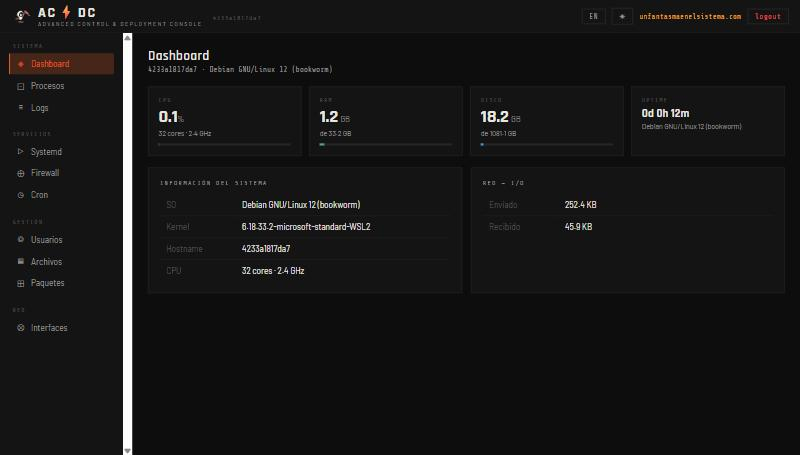
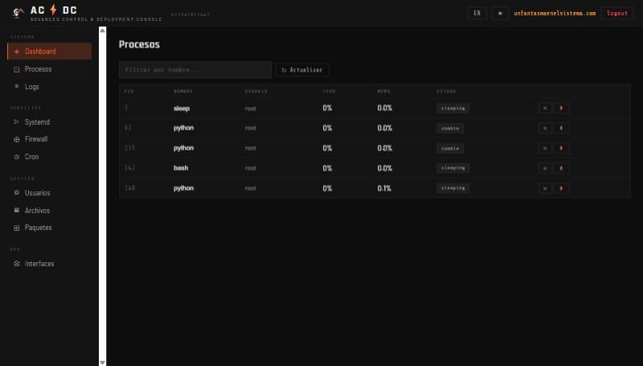
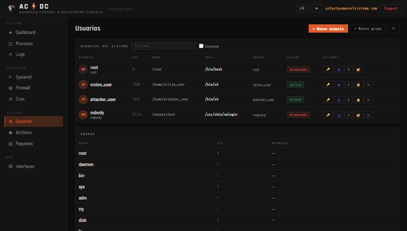
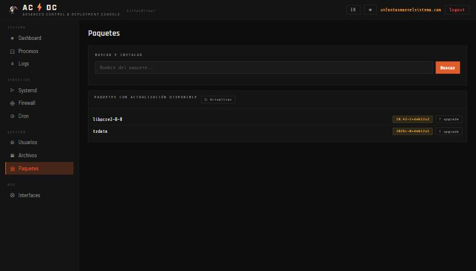

<div align="center">
  

  # AC⚡DC Console
  ### Advanced Control & Deployment Console

  <p align="center">
    <b>Panel web ligero para administrar un servidor Linux desde el navegador: sistema, procesos, logs, servicios, firewall, cron, usuarios, ficheros, paquetes y red.</b>
  </p>

  <p align="center">
    
    
    
    
    <a href="LICENSE"></a>
  </p>

  <p align="center">
    <strong>Desarrollado por <a href="https://www.unfantasmaenelsistema.com/">Un Fantasma en el Sistema</a></strong>
  </p>
</div>

---

> [!WARNING]
> **Este panel da control de root completo del servidor.** Quien inicie sesión puede matar procesos, cambiar el firewall, gestionar usuarios, borrar ficheros e instalar paquetes. Trátalo como una clave de root: por defecto solo escucha en `127.0.0.1` y así debería seguir salvo que sepas exactamente por qué lo cambias. Ver [Seguridad](#-seguridad).

---

## 📑 Tabla de Contenidos

1. [Acerca del Proyecto](#-acerca-del-proyecto)
2. [Capturas](#-capturas)
3. [Módulos Incluidos](#-módulos-incluidos)
4. [Requisitos](#-requisitos)
5. [Instalación Rápida](#-instalación-rápida)
6. [Gestión del Servicio](#-gestión-del-servicio)
7. [Configuración](#-configuración)
8. [Seguridad](#-seguridad)
9. [Acceso Remoto Seguro](#-acceso-remoto-seguro)
10. [Estructura del Proyecto](#-estructura-del-proyecto)
11. [Tecnologías Utilizadas](#-tecnologías-utilizadas)
12. [Changelog](#-changelog)
13. [Créditos y Licencia](#-créditos-y-licencia)

---

## 🎯 Acerca del Proyecto

**AC⚡DC Console** reúne en una sola interfaz web las tareas de administración del día a día de un servidor Linux, sin dependencias pesadas: un backend en **Python + Flask** con `psutil`, instalado como servicio de **systemd** con un único script.

Está pensado para servidores domésticos o de laboratorio, VPS personales y prácticas de administración de sistemas, donde ver el estado del sistema en tiempo real ayuda además a entender qué hacen por debajo las herramientas clásicas de Linux: cada módulo es la cara visible de `journalctl`, `systemctl`, `ufw`, `crontab`, `useradd` o `apt`.

---

## 📸 Capturas

| | |
|---|---|
|  |  |
|  |  |

---

## 🧩 Módulos Incluidos

| Módulo | Descripción |
| :--- | :--- |
| **📊 Dashboard** | CPU, RAM, disco, uptime e información del sistema en tiempo real |
| **⚙️ Procesos** | Lista de procesos con consumo de CPU/MEM, filtro y finalización (`kill`) |
| **📜 Logs** | Visor de `journalctl` (syslog, kernel, auth, nginx, docker) |
| **🔧 Systemd** | Arrancar, parar y reiniciar servicios |
| **🛡️ Firewall** | Estado de UFW y gestión de reglas ALLOW / DENY |
| **⏰ Cron** | Ver, añadir y eliminar tareas programadas |
| **👥 Usuarios** | Listar, crear, eliminar, bloquear y desbloquear usuarios; cambiar contraseña, grupos y shell; crear y eliminar grupos |
| **📁 Archivos** | Explorador de ficheros con visor de texto y borrado |
| **📦 Paquetes** | Buscar, instalar, eliminar y actualizar paquetes APT |
| **🌐 Red** | Interfaces, direcciones IP y MAC, estadísticas TX/RX |

---

## 📋 Requisitos

- **Linux** con **systemd** (Ubuntu/Debian recomendado; el núcleo del panel también funciona en Fedora o Arch).
- **Python 3.8+**. El instalador crea un entorno virtual propio (`.venv`) e instala `flask` y `psutil`; en Debian/Ubuntu instala `python3-venv` si falta.
- **ufw** para el módulo de firewall y **apt** para el de paquetes: en distribuciones sin ellos, esos dos módulos no tendrán efecto aunque el resto funcione.
- Permisos de administrador (`sudo`) para instalar el servicio.

---

## 🚀 Instalación Rápida

```bash
# 1. Clona el repositorio en tu servidor Linux
git clone https://github.com/unfantasmaenelsistema/acdc-console.git
cd acdc-console

# 2. (Opcional) Sustituye el logo por el tuyo
cp tu-logo.png static/logo.png

# 3. Instala con un comando
chmod +x install.sh
sudo ./install.sh install
```

El instalador crea el entorno virtual, instala las dependencias, registra el servicio `acdc-console` en systemd y **te obliga a fijar la contraseña de administrador antes de arrancarlo**: no hay ni un momento en que el panel quede expuesto con la contraseña de fábrica.

Después abre en el navegador del propio servidor:

```
http://127.0.0.1:8080
Usuario: admin  ·  Contraseña: la que acabas de fijar
```

> Para usarlo desde otro equipo sin exponerlo a la red, ver [Acceso Remoto Seguro](#-acceso-remoto-seguro).

---

## 🔄 Gestión del Servicio

```bash
sudo ./install.sh start      # Arrancar
sudo ./install.sh stop       # Parar
sudo ./install.sh restart    # Reiniciar
./install.sh status          # Ver estado
./install.sh logs            # Ver logs en tiempo real
./install.sh passwd          # Cambiar contraseña
sudo ./install.sh uninstall  # Desinstalar (conserva los ficheros de la aplicación)
```

---

## ⚙️ Configuración

Toda la configuración vive en `config.json`:

```jsonc
{
  "username": "admin",
  "password_hash": "...",          // Hash SHA-256 de la contraseña (lo gestiona ./install.sh passwd)
  "port": 8080,                    // Puerto de escucha
  "host": "127.0.0.1",             // 0.0.0.0 para escuchar en todas las interfaces (ver Seguridad)
  "session_timeout_minutes": 60,   // Caducidad de la sesión por inactividad
  "site_url": "https://www.unfantasmaenelsistema.com"
}
```

Tras cambiarlo: `sudo ./install.sh restart`.

---

## 🔒 Seguridad

Este panel da control de root completo del servidor (procesos, systemd, firewall, cron, usuarios, ficheros, paquetes). Lo que el código garantiza hoy:

- **Sin contraseña de fábrica activa**: `sudo ./install.sh install` obliga a fijar una contraseña antes de arrancar el servicio.
- **Solo local por defecto**: escucha en `127.0.0.1`. Cambiar `"host"` a `"0.0.0.0"` debe ser una decisión explícita tuya.
- **Sesiones que caducan** tras 60 minutos de inactividad real (configurable con `session_timeout_minutes`); cada petición autenticada renueva el temporizador.
- **Protección contra fuerza bruta**: `/api/login` bloquea una IP durante 5 minutos tras 5 intentos fallidos.
- **Contraseñas validadas**: se rechazan saltos de línea en las contraseñas que se pasan a `chpasswd`, para impedir que una contraseña manipulada cambie la de otro usuario.
- **Permisos sudo acotados**: el instalador añade en `/etc/sudoers.d/acdc-console` únicamente `ufw` y `kill` sin contraseña para el usuario del servicio.

**Lo que no hace:** no hay HTTPS propio, ni roles o varios administradores, ni registro de auditoría de acciones. Para acceso remoto permanente, ponlo detrás de un proxy inverso con HTTPS; para servidores de producción con varios administradores, valora herramientas con control de acceso por roles.

---

## 🔐 Acceso Remoto Seguro

No hace falta abrir el panel a la red para usarlo desde tu equipo. La opción más sencilla es un **túnel SSH**: el panel sigue escuchando solo en `127.0.0.1` del servidor y tu navegador llega a él a través de la conexión SSH cifrada.

```bash
ssh -L 8080:127.0.0.1:8080 usuario@tu-servidor
# y en tu navegador local: http://127.0.0.1:8080
```

Si necesitas acceso permanente, usa **nginx** (u otro proxy inverso) con **HTTPS** delante del panel, en lugar de exponer `0.0.0.0:8080` directamente.

---

## 📂 Estructura del Proyecto

```text
acdc-console/
├── app.py                 # Backend Flask: API REST de los 10 módulos, login y sesiones
├── install.sh             # Instalador y gestor del servicio (install/start/stop/passwd/uninstall...)
├── config.json            # Configuración: usuario, hash de contraseña, host, puerto, sesión
├── requirements.txt       # Dependencias Python (flask, psutil)
├── templates/
│   ├── index.html         # Interfaz del panel
│   └── login.html         # Pantalla de inicio de sesión
├── static/
│   └── logo.png           # Logotipo mostrado en el panel
├── docs/
│   └── screenshots/       # Capturas del README
├── LICENSE                # Licencia MIT
└── README.md
```

---

## 🛠️ Tecnologías Utilizadas

| Categoría | Tecnología | Propósito |
| :--- | :--- | :--- |
| **Backend** | [Python](https://www.python.org/) 3.8+ · [Flask](https://flask.palletsprojects.com/) 3.x | API REST y servidor web del panel |
| **Métricas del sistema** | [psutil](https://github.com/giampaolo/psutil) | CPU, memoria, disco, procesos y red |
| **Servicio** | systemd + `install.sh` | Arranque automático, reinicio ante fallos y logs en journald |
| **Herramientas del sistema** | `journalctl`, `systemctl`, `ufw`, `crontab`, `useradd`/`chpasswd`, `apt` | Lo que el panel ejecuta por debajo en cada módulo |
| **Frontend** | HTML, CSS y JavaScript sin frameworks | Interfaz ligera servida por Flask |

---

## 📝 Changelog

**2026-10-05 — Verificación real de los fixes de seguridad**

Se montó el panel desde cero en un contenedor Debian 12 desechable (con systemd real para la instalación vía `install.sh`) y se reprodujeron en vivo, sobre el código previo a estos fixes, los tres hallazgos más graves antes de confirmarlos ya corregidos:

- 🐛 **La app no arrancaba en absoluto**: `/api/processes` estaba definido dos veces (copia/pega), y Flask se negaba a arrancar con `AssertionError: View function mapping is overwriting an existing endpoint function: api_processes`. Reproducido con el `install.sh install` real (vía systemd) y arrancando `app.py` directamente. Corregido eliminando el duplicado.
- 🔓 **RCE real en `./install.sh passwd`**: la contraseña se interpolaba sin escapar dentro de un script `python3 -c "..."`; una contraseña con una comilla simple permitía ejecutar código Python arbitrario. Confirmado con un payload que crea un fichero de prueba. Corregido pasando la contraseña como variable de entorno en vez de interpolarla en el código fuente.
- 🔓 **Sobrescritura de la contraseña de cualquier usuario (incluido root)**: `/api/users/create` y `/api/users/<u>/passwd` pasaban la contraseña sin validar a `chpasswd` vía stdin (`usuario:contraseña`); una contraseña con un salto de línea inyectaba una segunda línea y cambiaba la contraseña de *otro* usuario del sistema. Confirmado creando un usuario víctima y comprobando que su hash en `/etc/shadow` cambiaba al "crear" un usuario distinto con el payload en el campo contraseña. Corregido rechazando contraseñas con `\n`/`\r`.

También se verificó en vivo (no solo lectura de código) que tras el fix: el login bloquea tras 5 intentos fallidos (429, incluida la contraseña correcta mientras dura el bloqueo), y que el panel completo (Dashboard, Procesos, Usuarios, Archivos, Paquetes, Cron, Firewall) funciona de extremo a extremo con datos reales del sistema una vez corregido el bug de arranque.

**No se pudo verificar en esta pasada** (limitación del entorno de pruebas, no del código): los módulos que dependen de `systemctl`/`ufw` reales no se ejercitaron más allá de confirmar que responden sin error, al evitar un segundo contenedor con systemd tras encontrarse inestable la primera vez en este host.

---

## 👤 Créditos y Licencia

Creado y desarrollado por **[Un Fantasma en el Sistema](https://www.unfantasmaenelsistema.com/)**.

Este proyecto se distribuye bajo la licencia **MIT**. Consulta el archivo [LICENSE](LICENSE) para más detalles.

> **Aviso de responsabilidad:** úsalo solo en servidores que administres tú. Prueba primero en una máquina virtual o un servidor de laboratorio antes de instalarlo en un equipo con datos importantes.

<div align="center">
  <sub>AC⚡DC Console · Un Fantasma en el Sistema</sub>
</div>
